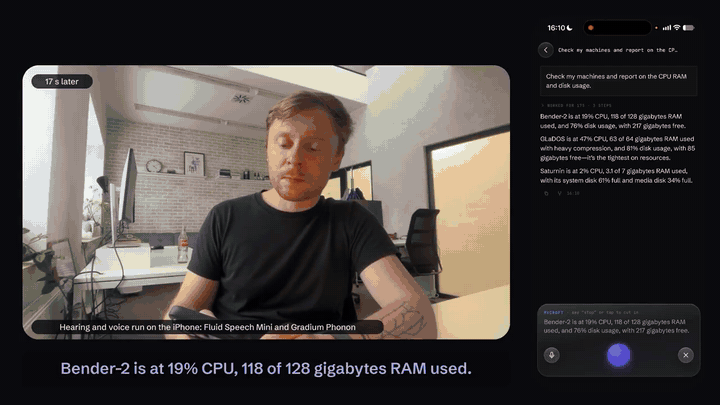

# Mycroft

A self-modifying, durable agent that lives on your iPhone. The brain is on the phone; the hands are on your machines.

Mycroft Holmes was the brother who stayed in his armchair while others did the legwork. This Mycroft sits in your
pocket, and your Macs and Linux servers do the legwork.

<a href="https://x.com/dontpanicv/status/2113699595947569467"></a>

▶ **[Watch the 2-minute demo on X](https://x.com/dontpanicv/status/2113699595947569467)**: pairing machines, driving a Mac from the phone, and Mycroft rewriting
its own screen to add a live dashboard of every machine, then rolling it back.

## Why Mycroft

- **The agent lives on the phone.** The agent loop, conversation state, model credentials and the agent's own source
  code are on your iPhone. Every step is committed to durable storage before it is shown, so a stopped run picks up
  where it was.
- **It changes itself.** The agent's behaviour (`extension.js`) and its whole screen (`ui/`, web code with Preact) live
  in the app's Documents folder, not in the signed bundle. The agent edits them, previews the screen off-screen and
  activates it. The code is swapped, the screen reloads in place, and the turn that made the edit carries on.
  Known-good generations are kept, so you can roll back. The screen can call every tool the agent has
  ([ADR 0004](docs/decisions/0004-self-modification-by-generations.md), [0009](docs/decisions/0009-self-editable-web-ui.md), [0015](docs/decisions/0015-the-screen-calls-tools.md)).
- **It has hands on your machines.** `hands` is a small daemon for macOS and Linux. Add a machine from the app, paste
  one command into its terminal, and the agent gets files, shell, and supervised jobs that keep running when the
  phone goes offline. It works over Wi-Fi, Tailscale, NetBird or the phone's hotspot, on a pinned TLS WebSocket
  ([ADR 0008](docs/decisions/0008-hands-transport-pairing.md)).
- **It drives your Mac.** [Cua Driver](https://github.com/trycua/cua) is linked into `hands`, and the agent on the
  phone uses Cua's tools directly. It asks you before risky actions such as deleting, sending or paying
  ([ADR 0018](docs/decisions/0018-computer-use-with-cua-driver.md)).
- **Threads, and one that never ends.** Several conversations run in parallel, and any of them can use any paired
  machine. Each has drafts, queue or steer, and fork. **Mycroft ∞** is one chat that never ends: a memory tree folds
  old messages into short summaries, and it hands work to the other threads
  ([ADR 0012](docs/decisions/0012-threads-like-t3.md), [0020](docs/decisions/0020-infinite-chat.md), [0021](docs/decisions/0021-infinite-chat-coordinates-threads.md)).
- **Talk or type.** Hold the mic and let go to send, or tap it to keep it on. Speech is recognized on the iPhone by
  Fluid Speech Mini. The wave next to the mic turns a thread into a hands-free conversation: Mycroft answers aloud in
  Gradium's Phonon voice, on the phone, and you can talk over it to cut in
  ([ADR 0010](docs/decisions/0010-voice-in-every-thread.md), [0016](docs/decisions/0016-conversation-mode.md), [0017](docs/decisions/0017-fluid-speech-mini-only.md)).
- **It keeps working in the background.** Runs you start continue after you leave the app, through
  `BGContinuedProcessingTask` and `LongRunningIntent`, with progress in the Dynamic Island.
- **Your ChatGPT subscription.** The default model is **Sol 6.1** via the `openai-codex` provider, signed in with the
  device-code flow that Codex uses ([ADR 0003](docs/decisions/0003-sol-61-via-chatgpt-device-login.md)).

## How it works

The design builds on Mario Zechner's "pim" ([Pi Durable](https://github.com/earendil-works/pi/tree/main/packages/durable)
on an Android phone) and adapts it to what iOS 27 does and doesn't allow. Pi Durable runs in JavaScriptCore on the
phone through [PiDurableKit](https://github.com/finnvoor/PiDurableKit). The native app hosts the agent's screen in a web
view and gives it native tools: hands, desktop control, showing images and pages, editing itself, voice, and background
runs. See [the architecture](docs/ARCHITECTURE.md), [the decisions](docs/decisions/),
[the design direction](docs/DESIGN.md) and [the research](docs/research/README.md) for how we got here.

## Run it yourself

You need a Mac with Xcode 27, [XcodeGen](https://github.com/yonaskolb/XcodeGen), an iPhone on iOS 27 and a ChatGPT
subscription.

```sh
cd ios
scripts/fetch-fluid-speech.sh      # the dictation model (~240 MB), kept outside git
scripts/fetch-phonon.sh            # the conversation voice (~150 MB)
cp Config/Local.example.xcconfig Config/Local.xcconfig   # your signing team and bundle id
xcodegen generate && open Mycroft.xcodeproj
```

Run the `Mycroft` scheme on your iPhone and sign in with ChatGPT. Then tap **Add machine** and paste the command it
gives you into a terminal on your Mac or Linux machine. [hands/README.md](hands/README.md) covers the daemon, its
permissions on macOS, and installing it by hand.

## Layout

| Path | What |
|---|---|
| [`ios/`](ios/) | Native iOS 27 host: the web view that shows the agent's own screen, the JavaScriptCore runtime (PiDurableKit), native tools (hands, desktop control, show, self-edit), voice, background-task controller. |
| [`agent/`](agent/) | The agent's own code as shipped (generation 0), which it rewrites on the phone: `extension.js` (identity, style, JavaScript tools) and `ui/`, the whole screen. |
| [`hands/`](hands/) | The `hands` daemon for macOS and Linux. |
| [`docs/`](docs/) | Architecture, decisions, design direction, research. |
| [`spikes/`](spikes/) | Throwaway experiments that produced evidence for the design. |

## Credits

Mycroft stands on other people's work. Thank you.

**The idea.** Mario Zechner ([@badlogicgames](https://x.com/badlogicgames)) ran Pi Durable on an Android phone ("pim"): the brain on the phone, the hands elsewhere, an agent that edits itself. Mycroft is that idea brought to iOS ([research](docs/research/README.md)).

**Built on**

- [Pi, Pi Durable and pi-env](https://github.com/earendil-works/pi) (MIT) by Mario Zechner, Armin Ronacher ([@mitsuhiko](https://x.com/mitsuhiko)) and Earendil ([@earendilworks](https://x.com/earendilworks)). The agent runs on Pi Durable, and `hands` is built on the pi-env daemon ([NOTICE](hands/NOTICE)).
- [PiDurableKit](https://github.com/finnvoor/PiDurableKit) (CC0) by Finn Voorhees: Pi Durable on JavaScriptCore, the app's runtime.
- [Cua Driver](https://github.com/trycua/cua) (MIT) by Cua ([@trycua](https://x.com/trycua)), linked into `hands` for desktop control.
- [Fluid Speech Mini](https://huggingface.co/FluidVoice-Labs/fluid-speech-mini-coreml) (CC-BY-4.0) by FluidVoice ([@FluidVoiceApp](https://x.com/FluidVoiceApp)) for dictation, built on NVIDIA's Parakeet TDT 0.6B v3 and Moondream's Parakeet Ultra.
- [Phonon 31m](https://huggingface.co/gradium/phonon-31m-en) (Apache-2.0) by Gradium ([@GradiumAI](https://x.com/GradiumAI)), Mycroft's voice in a conversation. Jon Taylor ([@JonPTaylor](https://x.com/JonPTaylor)) pointed us to it.
- [FluidAudio](https://github.com/FluidInference/FluidAudio) (Apache-2.0) and the [Core ML conversions](https://huggingface.co/FluidInference/pocket-tts-coreml) by FluidInference, which run both speech models on the Neural Engine.
- [Preact](https://preactjs.com) (MIT) and [htm](https://github.com/developit/htm) (Apache-2.0) for the agent's screen; [JetBrains Mono](https://github.com/JetBrains/JetBrainsMono) and [Schibsted Grotesk](https://github.com/schibsted/schibsted-grotesk) (SIL OFL) for its type ([licenses](docs/licenses/)).

**Ideas taken from**

- [UniiChat](https://github.com/VictorTaelin/UniiChat) (Apache-2.0) by Victor Taelin: the memory tree behind Mycroft ∞, the infinite chat ([ADR 0020](docs/decisions/0020-infinite-chat.md)).
- [T3 Code](https://github.com/pingdotgg/t3code) (MIT) by Ping.gg: how threads work, with drafts, queue or steer, and fork ([ADR 0012](docs/decisions/0012-threads-like-t3.md)).
- [pi-phone](https://github.com/picassio/pi-phone) (MIT) by Picassio ([@ocbieuvang](https://x.com/ocbieuvang)): handing a session off to Pi on a server.
- [grep.ai](https://grep.ai/) and iOS 27's Liquid Glass: the visual style ([design direction](docs/DESIGN.md)).
- Computer use before Cua ([ADR 0006](docs/decisions/0006-computer-use-with-jev.md), since replaced), which shaped the design: [jev-use](https://github.com/savka777/jev-use) by sav ([@savboj](https://x.com/savboj)), [Computah](https://github.com/musubipapi/computah) by Andy Gao ([@instantricecook](https://x.com/instantricecook)), [Jev](https://docs.typesafe.ai/) by typesafe.ai ([@typesafeai](https://x.com/typesafeai)) and [pi-computer-use](https://github.com/injaneity/pi-computer-use) by injaneity.
- Rui Carmo ([@rcarmo](https://x.com/rcarmo)), whose Pi-on-iPhone report and [ios-linuxkit](https://github.com/rcarmo/ios-linuxkit) answered "can this run on iOS?", and Underdog's Bark 3.0, the first dictation model we built and measured ([ADR 0014](docs/decisions/0014-dictation-fluid-speech-mini.md)).

The name is Mycroft Holmes, and a nod to Mike in Heinlein's *The Moon Is a Harsh Mistress*.

## Status

Pre-alpha, built in public. It runs on my iPhone, and it changes often. See the [roadmap](docs/ROADMAP.md)
and [the launch post](https://x.com/dontpanicv/status/2113699595947569467).

## License

[MIT](LICENSE)
